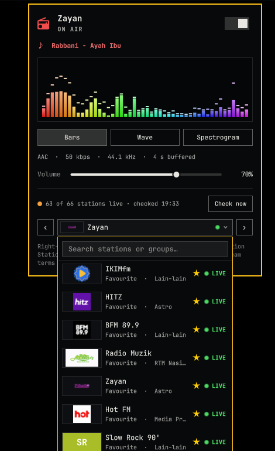

# Radio Malaysia for Omarchy

A bar widget for [Omarchy](https://omarchy.org) that plays Malaysian radio.
It has 66 stations from RTM, Astro, Media Prima and others, and a colourful
audio visualizer.



## Features

- **66 stations** in five groups: RTM Nasional, RTM Negeri, Astro, Media
  Prima and Lain-lain.
- **Searchable station picker** with station logos. Type a name or a group
  ("astro", "sabah"). **‹ ›** play the previous or next station.
- **Favourites:** click ☆ on a station to pin it to the top of the list.
- **Live or down:** each station shows whether it answered the last check
  (rechecked every 30 minutes while the panel is open, or with **Check now**).
- **Visualizer** in three modes: **Bars**, **Wave** and **Spectrogram**. While
  a station plays, the bar icon becomes five small rainbow bars.
- **Stream info:** codec, bitrate, sample rate, buffer and the current song
  title when the station sends one.
- Playback runs in mpv, so it keeps going when the shell restarts. It also
  shows in Omarchy's media controls.
- English and Bahasa Melayu text, following Omarchy's language setting.

Left-click the bar icon to open the panel. Right-click it to stop, or to resume
the last station.

## Install

```bash
omarchy plugin add https://github.com/pdoc81/omarchy-radio-malaysia --enable
omarchy pkg add cava   # for the visualizer
```

Everything else it needs ships with Omarchy: mpv, mpv-mpris, ffmpeg, jq, socat,
ImageMagick and curl. Without cava the radio still works; the panel just says
how to turn the visualizer on.

Update with `omarchy plugin update pdoc81.radio-malaysia`. If the panel doesn't
pick up an update, run `omarchy restart shell`.

## Command line and key bindings

The plugin includes a small script, `bin/radio`, that you can also run
yourself:

```bash
~/.config/omarchy/plugins/pdoc81.radio-malaysia/bin/radio play hitz
~/.config/omarchy/plugins/pdoc81.radio-malaysia/bin/radio stop
~/.config/omarchy/plugins/pdoc81.radio-malaysia/bin/radio volume 50
```

Shell commands you can bind to keys in `~/.config/hypr/bindings.lua`:

```bash
omarchy-shell radio-malaysia toggle       # open or close the panel
omarchy-shell radio-malaysia openPicker   # open straight into station search
omarchy-shell radio-malaysia playPause    # stop, or resume the last station
omarchy-shell radio-malaysia mode wave    # bars | wave | spectrogram
omarchy-shell radio-malaysia fav hitz     # star or unstar a station
```

## Stations

Stations are listed in [`stations.json`](stations.json) (`id`, `group`,
`name`, stream `url`, optional `logoUrl`). Pull requests with new or fixed
streams are welcome. Please check that a stream plays in mpv first.

## Privacy and network use

- Audio streams straight from each broadcaster to your computer. Nothing is
  relayed or recorded. Broadcasters can see your IP address, as with any
  internet radio.
- The health check connects briefly to every station, at most six at a time
  and at most once every 30 minutes, unless you press **Check now**.
- Logos are downloaded once from each broadcaster's own site into
  `~/.cache/radio-malaysia/logos`. Only HTTPS images up to 25 MB are accepted,
  and they are converted to small PNGs before display.
- Your settings (last station, volume, visualizer mode, favourites) are kept in
  `~/.local/state/radio-malaysia/`.

## Credits

Station data comes from [Radio Browser](https://www.radio-browser.info/) and
RTM's public station list. Logos and streams belong to their broadcasters and
are not included in this repository. The station picker is adapted from
Omarchy's own dropdown (MIT). See [THIRD_PARTY_NOTICES.md](THIRD_PARTY_NOTICES.md).

## Licence

MIT. See [LICENSE](LICENSE).
